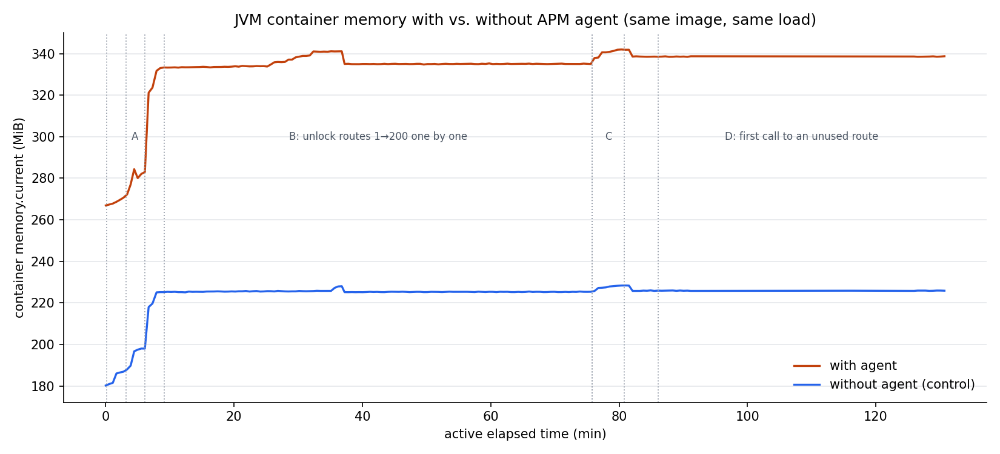

# JVM APM エージェントのメモリオーバーヘッド実測

Spring Boot のコンテナに商用 APM のバイトコード計装型エージェントを入れたとき、メモリがどれだけ増え、何によって増えるのかを測った記録。実施日は 2026-09-03。

## 動機

きっかけは Coroot の [OpenTelemetry SDK overhead](https://docs.coroot.com/tracing/opentelemetry-overhead/)。同じ小さな HTTP サービスを8言語で書き、計装なし/ありを同じ負荷(1,000 req/s 固定)で比べている。Java(OTel Java agent)ではメモリ(RSS)が 310 → 459 MB で、約150 MB の増分はサンプリング率を変えてもほぼ変わらず、エージェント自体(クラス、計装したバイトコード、SDK)のコストとされていた。

これを見て、サンプリング率ではなく「負荷の大きさ」と「実行されたコードの量」を変えたとき、増分がどう動くかを知りたくなった。具体的には次の2点。

1. アプリごとに特性は違うのに、エージェントのメモリに一律の目安が示されることが多いのはなぜか
2. リクエストが急増したとき、エージェントのメモリは増えるのか

## 実験の設計

エージェントあり/なしの2つの Deployment に同じ負荷をかけ、差分をエージェント由来の増分とした。メソッドを初めて呼んだときの JIT コンパイルやクラスロードは、エージェントがなくても JVM 自体がメモリを使うため、エージェントありの Pod だけでは区別できない。そのため対照群を置いた。

| | `memlab` | `memlab-baseline`(対照群) |
|---|---|---|
| イメージ・Deployment 設定 | 同一(Java 17, Spring Boot, `-Xmx256m` 固定) | 同一 |
| APM エージェント | あり(Kubernetes オペレーターで自動注入) | なし(Pod の annotation で注入を除外。`/proc/1/maps` にエージェントのライブラリが無いことを確認) |

- アプリは `route0`〜`route200` の201エンドポイントで、それぞれ別メソッド(`scripts/generate_routes.py` で生成)。
- メモリは両 Pod の cgroup v2 `memory.current` を10秒間隔でサンプリングした。監視製品側のメトリクスは使っていない。
- `memory.current` は RSS ではなく、page cache(エージェントのライブラリファイルやログ書き込みなど)も含む。そのため RSS で測った値より大きめに出る。

### 仮説と負荷シナリオ

| Step | 負荷 | 確かめる仮説 |
|---|---|---|
| A | route1 だけに RPS 1 → 10 → 100(各3分) | H_load:リクエスト量そのものではメモリは増えない |
| B | RPS 5 固定で、route を20秒ごとに1つずつ解禁(1→200) | H_coverage:初めて実行したコードパスの数に応じて増える |
| C | 全ルート既知の状態で RPS 100 に急増(5分) | H_load の反証テスト |
| D | 40分以上安定させたあと、未使用の route0 を1回だけ呼ぶ | H_longtail:安定後も、まれなコードパスで遅れて段差が出る |

## 結果



| フェーズ | あり (MiB) | なし (MiB) | 差分 (MiB) |
|---|---:|---:|---:|
| Step A RPS=1 | 267.2 | 180.6 | 86.6 |
| Step A RPS=10 | 271.3 | 187.2 | 84.1 |
| Step A RPS=100 | 283.0 | 198.0 | 85.0 |
| Step B 開始 | 333.3 | 225.2 | 108.2 |
| Step B route80 解禁 | 341.1 | 227.2 | 113.9 |
| Step B route200 解禁(完了) | 335.1 | 225.5 | 109.6 |
| Step C RPS=100 急増 | 342.0 | 228.5 | 113.5 |
| Step D 直後 → 43分後 | 338.6 → 338.6 | 225.9 → 225.8 | 112.7 → 112.8 |

表の値は `scripts/analyze.py` で `driver/logs/` の生データから再計算できる。

### 仮説ごとの判定

- **H_load:この条件では概ね支持。** RPS を100倍にしても差分は 86.6 → 84.1 → 85.0 MiB で横ばい。アプリ全体のメモリは +16〜17 MiB 増えたが、対照群も同程度増えているので JVM や Web サーバー側の挙動。
  - ただし各リクエストは `Map.of()` を返すだけで一瞬で終わり、同時に処理中のリクエスト数も、1リクエストあたりのトレースの長さも小さい。分散トレースのデータは処理中のリクエストごとに持つので、同時実行数が多い、またはトレースが長いアプリでは負荷に応じて増える可能性がある。今回はそこを試していない。
  - 例外として、Step A の高負荷から Step B に移る地点で差分が 85.0 → 108.2 MiB と +23 MiB 増えた。同じメソッドへの呼び出しが JIT 最適化(C2 コンパイル)の閾値に達したタイミングと考えているが、JIT ログでは確認していない。
- **H_coverage:部分的に支持。** route80 までは差分が 108.2 → 113.9 MiB とわずかに増えたが、その後116ルートを追加しても 109.7 → 109.6 MiB でほぼ変わらなかった。コードパスの数に比例するのではなく、早い段階で頭打ちになる。
- **H_longtail:支持されず。** 安定後に未使用ルートを1回呼んでも、43分間、測定誤差を超える変化は無かった。

### 動機の2点について(暫定)

1. エージェントのメモリは「ほぼ固定の基盤コスト(今回は約85〜110 MiB)」と「実行されたコードやトレースの量に応じた追加コスト」の2層と考えられる。前者はアプリによらず似た水準になるので、一律の目安が粗く成り立つのだと思う。
2. 単純なリクエスト・低い同時実行数という今回の条件では、リクエスト数そのものでは増えなかった。増えたのは、新しいコードを初めて実行したときと、よく使うコードが JIT 最適化されたときで、その後は頭打ちになった。

### Coroot の結果との比較

| | Coroot(OTel Java agent) | この実験 |
|---|---|---|
| 変えたもの | サンプリング率(off / 100 / 50 / 20 / 0%) | 負荷(RPS)と、実行したコードパスの数 |
| メモリの測り方 | RSS | cgroup `memory.current`(page cache を含む) |
| 増分 | 約150 MB(サンプリング率によらずほぼ一定) | 約85〜114 MiB(負荷によらずほぼ一定、コードの初回実行と JIT 最適化のタイミングで段階的に増加) |

エージェント、アプリ、ヒープ設定、メモリの指標が違うので、数値そのものは比べられない。「増分の大部分は使われ方によらない固定的なコスト」という傾向は一致している。

## 限界と次にやること

- 各ルートは `Map.of()` を返すだけの単純なメソッドなので、今回の値は単純なコードでの下限。分岐・例外・DB 呼び出しを含むメソッドにして同じ実験をやり直す。
- 同時実行数とトレースの長さを変えた実験をする(H_load を本当に確かめるにはこれが要る)。
- RSS も同時に記録し、`memory.current` との差を見る。
- Java / Spring Boot で1回だけの実験。他の言語や、アプリ規模の違いによる比較(H_size)はしていない。
- 実験中にドライバーが外部要因で約3時間止まり、route84 から再開した(`driver/logs/*_resume_*`)。グラフの横軸はその停止時間を除いた経過時間。Step A は影響を受けていない。
- サンプリングに一部欠測があるが、各イベントの前後はデータが揃っている。

## 再現手順

前提:APM エージェントを注入できる Kubernetes クラスター、コンテナレジストリ、`kubectl`。`k8s/deployment-baseline.yaml` の annotation は、使うエージェントの注入除外の設定に置き換える。

```bash
# 1. ビルドとデプロイ(Azure Container Registry を使った場合。他のレジストリなら build_and_push.sh を差し替える)
ACR_NAME=<registry> ./scripts/build_and_push.sh
ACR_NAME=<registry> ./scripts/deploy.sh                       # エージェントあり
sed "s#REPLACE_ME/memlab:latest#<registry>.azurecr.io/memlab:latest#" k8s/deployment-baseline.yaml | kubectl apply -f -   # 対照群

# 2. エージェントの注入有無を確認(ライブラリ名は製品に合わせる)
kubectl exec <memlab-pod> -- cat /proc/1/maps | grep -i <agent-library-name>

# 3. メモリのサンプリング開始(別ターミナル)
./scripts/sample_memory.sh 10

# 4. 負荷をかける(あり/なしの両方に、同じシナリオを同時に流す)
kubectl port-forward svc/memlab 8080:8080 &
kubectl port-forward svc/memlab-baseline 8081:8080 &
cd driver
./run_experiment.sh ALL &                                  # Step A → B → C(あり)
BASE_URL=http://localhost:8081 ./run_experiment.sh ALL     # 同(なし)
# 十分安定させてから、両方に Step D
./run_experiment.sh D & BASE_URL=http://localhost:8081 ./run_experiment.sh D

# 5. 集計とグラフ
python3 scripts/analyze.py
python3 scripts/prepare_chart_data.py && python3 scripts/plot_chart.py
```

## ディレクトリ構成

```
java-app/   Spring Boot アプリ(201 エンドポイント)
k8s/        エージェントあり / なしの Deployment
driver/     負荷シナリオ(run_experiment.sh)と実験時の生ログ・メモリ CSV
scripts/    ビルド・デプロイ・サンプリング・集計・グラフ描画
docs/       グラフ
```

## 免責

個人の検証の記録で、所属組織や APM 製品のベンダーの見解を示すものではない。数値はこの環境とこの条件での1回の実測で、製品の公式な要件や性能値ではない。
